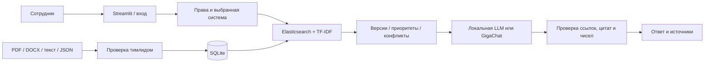
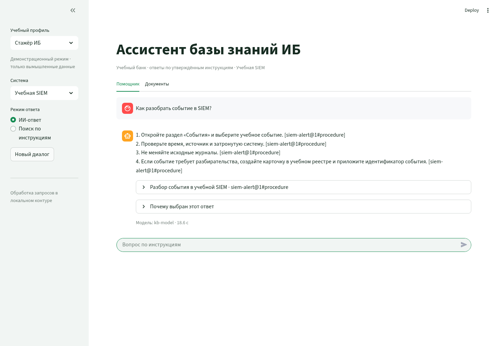

# Сбер · ИИ-ассистент внутренней базы знаний

**Проект 3 · БВТ2506.** Учебный RAG-прототип для стажёра отдела ИБ. [Команда и роли](docs/team.md) · [Техническое задание](docs/spec.md) · [Качество](docs/quality.md).

Все документы синтетические и не являются инструкциями Сбера. Учебные системы: реестр инцидентов, SIEM и VPN.

## Что делает проект

- **«Поиск по инструкциям»** — классический NLP-контур: документы → фрагменты → Elasticsearch/локальный backend → TF-IDF → источники. Есть отдельный обучаемый FastText baseline для сравнения.
- **«ИИ-ответ»** — настоящая языковая модель формирует шаги по разрешённым найденным фрагментам. Каждый шаг связан с источником и точной цитатой. Это не название для шаблонного ответа: при недоступности модели показывается ошибка.
- Пользователь выбирает систему. Контекст фильтруется по роли до передачи LLM. При смене пользователя, системы, режима или версии базы история очищается.
- Учтены действующие версии, приоритеты, размеченные конфликты, недостаток данных, загрузка и утверждение документов.





Проверка цитат не доказывает правильность всего пересказа. Условия согласования и запреты сохраняются точными формулировками. Для процедурного вопроса порядок и пропущенные императивные шаги использованного фрагмента дополнительно восстанавливаются по источнику. Ограничения и реальные результаты описаны в отчёте.

## Показ на компьютере

**Python 3.12** / [Ollama](https://ollama.com/download):

```bash
ollama pull qwen2.5:1.5b
```

Если Ollama не запущена как приложение/служба, откройте отдельный терминал и выполните `ollama serve`.

В папке проекта создайте окружение:

```bash
python -m venv .venv
```

Активация Linux/macOS: `source .venv/bin/activate`. Windows PowerShell: `.\.venv\Scripts\Activate.ps1`.

```bash
python -m pip install -r requirements.txt
python scripts/check_model.py
python run_local.py --demo
```

Откройте http://127.0.0.1:8501. Флаг `--demo` явно включает переключатель учебных профилей. В этом режиме доступны только вымышленные материалы. По умолчанию используются локальный backend и Ollama на `http://127.0.0.1:11434/v1`.

Без активации в Windows используйте `.\.venv\Scripts\python.exe` вместо `python`. Модель не входит в Git-репозиторий; после установки пакетов и модели обычные локальные запросы не требуют интернета.

## Вход по логину

Без `--demo` приложение использует серверные роли и парольный вход:

```bash
python -m kb.users create oleg --profile lead
python -m kb.users create trainee-ib --profile ib
python -m kb.users create trainee-support --profile support
python run_local.py
```

Пароль вводится скрыто. В SQLite сохраняются соль и PBKDF2-хеш, сессия живёт четыре часа. Паролей по умолчанию нет. Тимлид читает документы профиля ИБ и дополнительно принимает решения по предложениям. Для промышленного контура корпоративная SSO, защита входа и нагрузочные испытания остаются отдельными задачами.

## Настройки и отключение внешней модели

Скопируйте `.env.example` в `.env` при необходимости. Ключи и пользовательские базы не коммитятся. После изменения настроек перезапустите приложение.

| Переменная | Значение по умолчанию |
|---|---|
| `KB_BACKEND` | `local`; основной контейнерный режим — `elastic` |
| `KB_DB` | `.local/handbook.sqlite` |
| `LLM_PROVIDER` | `local` |
| `LLM_BASE_URL` | `http://127.0.0.1:11434/v1` |
| `LLM_MODEL` | `qwen2.5:1.5b` |
| `ALLOW_EXTERNAL_LLM` | `false` |
| `KB_DEMO_MODE` | `false` |

Для локального llama.cpp/OpenAI-совместимого сервера укажите его private/loopback адрес и имя модели. При разработке проверен Qwen2.5-1.5B-Instruct Q4_K_M через llama.cpp; параметры приведены в отчёте.

GigaChat включается **отдельно**: `LLM_PROVIDER=gigachat`, `LLM_MODEL=GigaChat`, `ALLOW_EXTERNAL_LLM=true` и `GIGACHAT_CREDENTIALS` либо `GIGACHAT_ACCESS_TOKEN` в окружении сервера. `GIGACHAT_SCOPE` по умолчанию `GIGACHAT_API_PERS`. Для доверенной корпоративной цепочки можно задать `GIGACHAT_CA_BUNDLE`. Проверка TLS остаётся включённой; секреты не отображаются в интерфейсе и сообщениях об ошибках.

При `ALLOW_EXTERNAL_LLM=false` обращения к GigaChat блокируются кодом. Для полностью локального режима также выберите `LLM_PROVIDER=local`. Поиска в интернете нет. Настройка управляет вызовами приложения и не заменяет сетевые правила организации.

## Полный стенд с Elasticsearch и Ollama

```bash
docker compose up --build --wait
docker compose exec ollama ollama pull qwen2.5:1.5b
docker compose exec app python -m kb.users create oleg --profile lead
```

Откройте http://127.0.0.1:8501. Для учебного переключателя профилей задайте `KB_DEMO_MODE=true` в `.env` перед запуском. Elasticsearch и Ollama не публикуют порты на хосте. Том SQLite, индекс и загруженная модель сохраняются. `docker compose down` останавливает стенд без удаления данных.

Первоначальная сборка и загрузка модели требуют сети. После подготовки обычный локальный запрос не скачивает модель и не вызывает внешний API. Стартовый план для замеров полного стенда: **4 vCPU / 8 ГиБ RAM / 20 ГиБ диска**, а не заявленный измеренный минимум.

## Проверки и учебные метрики

```bash
python -m unittest discover -v
python -m kb.benchmark --method tfidf
python -m kb.evaluate --split holdout
python -m kb.evaluate --split regression
```

Независимый от LLM retrieval-отчёт: `kb.benchmark`; проверка ожидаемых исходов классического сценария: `kb.evaluate`. Живой Elasticsearch:

```bash
docker compose exec -e KB_TEST_ES=1 app python -m unittest -v tests.test_elastic_live
docker compose exec app python -m kb.benchmark --backend elastic
```

Обучение и сравнение FastText на синтетическом корпусе:

```bash
python -m pip install -r requirements-ml.txt
python -m kb.embeddings
python -m kb.benchmark --method fasttext
```

Настоящая генерация проверяется отдельно и требует работающей модели:

```bash
python scripts/evaluate_ai.py
```

GitHub CI запускает локальные тесты при push/PR. Ручной workflow дополнительно проверяет Elasticsearch и браузер; реальная LLM включается отдельным параметром и загружает модель. Небольшие контрольные наборы не доказывают качество на банковских данных.

[Формат документов](docs/data-format.md) · [Показ](docs/demo.md) · [Ветки и запуск](docs/github-update.md) · [Изменения](CHANGES.md)
