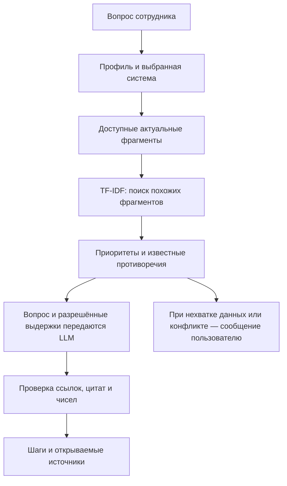

# Как работает проект простыми словами

## Четыре разные вещи

| Часть | Что делает | Где находится |
|---|---|---|
| Репозиторий GitHub | Хранит код, подготовленные документы, тесты и инструкции | `Flameek/sber-assistent`, ветка `feature/ai-assistant` |
| Приложение Streamlit | Показывает чат, документы, источники и панель тимлида | Запускается у вас, обычно http://127.0.0.1:8501 |
| Ollama и Qwen | Ollama запускает скачанную языковую модель Qwen2.5 1.5B | Ollama обычно слушает http://127.0.0.1:11434 |
| База знаний | Хранит утверждённые инструкции и их метаданные | SQLite; в Elasticsearch-режиме также строится индекс |

Скачивание репозитория не запускает сайт. Сайт не размещается автоматически на GitHub. Ollama не является нашим сайтом: она предоставляет API модели, к которому обращается Python-приложение.

Программа Ollama и веса Qwen скачиваются отдельно. В Git-репозитории нет гигабайтного файла модели. Точное расположение её весов зависит от настройки службы Ollama, в том числе `OLLAMA_MODELS`; не путайте этот каталог с `.local` нашего приложения.

## Что происходит при первом запуске

1. Приложение открывает SQLite-файл из переменной `KB_DB`.
2. Если опубликованных документов ещё нет, загружает исходный корпус из `data/documents.json`.
3. Для каждого документа выбирает последнюю опубликованную версию. В текущем корпусе 13 записей, но 12 действующих разделов: старая версия доступа не участвует в выдаче.
4. Показывает доступные текущему профилю системы и инструкции.
5. В Elasticsearch-режиме создаёт индекс снимка при обращении к поиску. Имя индекса зависит от содержимого базы.

Редактирование исходного JSON или `git pull` **не обновляет автоматически уже заполненную SQLite-базу**. Рабочие изменения вносят через загрузку и публикацию новой версии. Для исходного состояния показа создают другую базу, сохраняя рабочую.

## Как получается ответ

Разбиение на фрагменты нужно, чтобы работать с нужной частью инструкции. Для обычных загруженных файлов оно автоматическое: до 2500 символов с перекрытием. Для подготовленного JSON разделы задаёт автор. Русская морфология приводит слова к сопоставимым формам. TF-IDF оценивает совпадения слов с учётом их распространённости в доступных документах.

В полном режиме Elasticsearch хранит снимок и фильтрует кандидатов по профилю и области; финальное TF-IDF-ранжирование выполняет Python. Быстрый режим выполняет фильтрацию и поиск локально. FastText реализован как отдельный обучаемый эксперимент для сравнения метрик, **не как переключаемый поисковый метод сайта**.

До вызова LLM выбираются действующие документы, учитываются приоритеты и известные конфликты. Для ряда знакомых операций дополнительно проверяется тип действия: инструкция получения доступа не подставляется вместо отсутствующей инструкции отзыва. Модель получает отобранные цитаты и вопрос, а не всю базу.

LLM предлагает структуру ответа и подтверждающие цитаты. Программа проверяет существование источников, точность цитат и числовые параметры. В процедурных вопросах сохраняет исходные формулировки и порядок шагов, дополняет пропущенные действия и условия из использованного фрагмента. Поэтому часть видимого ответа — дословные сведения из инструкции. Это не свободный пересказ, которому приложение безоговорочно доверяет.

Если данных недостаточно, указывается известный ответственный. При конфликте сообщается о необходимости обращения к тимлиду. **Автоматического сообщения тимлиду, письма или тикета в другой системе сейчас нет.** В панели «Согласование» находятся предложения документов, а не все конфликтные вопросы.

## «Поиск по инструкциям» и «ИИ-ответ»

Первый режим выдаёт извлечённые сведения без вызова LLM. Второй применяет модель, если есть подходящий разрешённый контекст. Отказ по правам, отсутствие инструкции известной операции или размеченный конфликт могут завершиться **до вызова модели** даже в режиме «ИИ-ответ».

Подпись с моделью и временем появляется после фактического вызова модели. Если модель недоступна, приложение показывает ошибку и не выдаёт классический ответ за генерацию.

## Загруженный файл не переобучает модель

Qwen уже обучена её разработчиками. Мы используем готовые веса. При загрузке нового документа меняются SQLite и поисковый снимок, а не веса Qwen. При следующем вопросе нужный новый текст включается в запрос к модели. Это Retrieval-Augmented Generation, или RAG.

Модель может знать общие сведения о VPN из своего предварительного обучения, но правила учебного банка должна подтверждать доступными инструкциями. Правдоподобность фразы не заменяет источник. Проверка источников и цитат также не является доказательством полной смысловой правильности — это отдельно оценивает команда.

## Куда попадают файлы и история

Исходники демонстрационных файлов лежат в `demo/files`. При загрузке через сайт приложение **не сохраняет оригинальный PDF/DOCX в эту папку**: извлекает текст, принимает метаданные и сохраняет предложение в SQLite. После утверждения текст становится опубликованным. Кнопка «Открыть раздел инструкции» показывает сохранённый раздел, а не исходный бинарный файл PDF.

На экране хранится до 20 записей диалога. Реализовано ограниченное использование предыдущего пользовательского вопроса для простого уточнения; полного архива беседы модель не получает. История очищается при смене пользователя/профиля, системы, режима или опубликованного снимка, чтобы не переносить закрытые либо устаревшие ответы.

## Какие файлы кода за что отвечают

- `app.py` — интерфейс, вход, чат, загрузка и панель тимлида.
- `kb/store.py` — SQLite, предложения, версии и решения.
- `kb/importer.py` — извлечение текста и фрагментация.
- `kb/backend.py` — локальный backend и Elasticsearch.
- `kb/service.py` — морфология, TF-IDF и выбор источников.
- `kb/rag.py` — сбор контекста, вызов LLM и проверка ответа.
- `kb/llm.py` — локальный API и отключаемый GigaChat.
- `kb/users.py` — парольный вход и серверная роль.

Для работы реального банка потребуются отдельные испытания и корпоративная интеграция. В этом учебном проекте проверяются сценарии из протокола на вымышленных данных.
